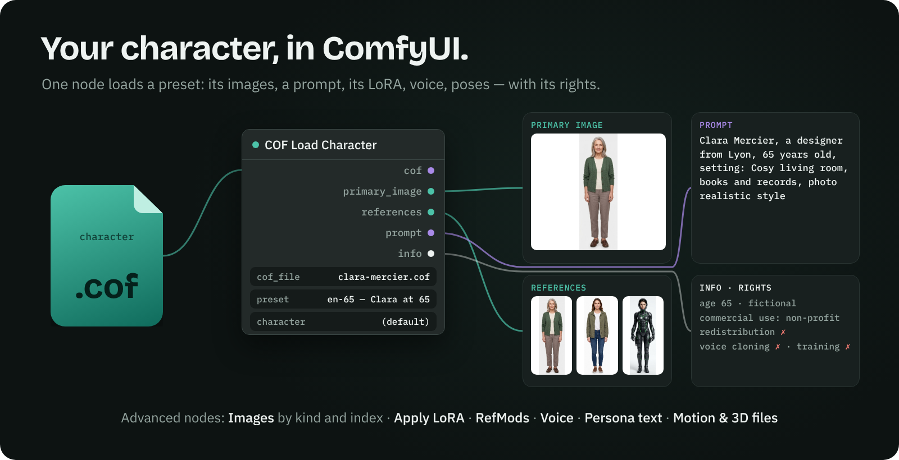

<p align="center"></p>

<h1 align="center">ComfyUI-COF</h1>

<p align="center"><b>Load a whole AI character in ComfyUI — with its rights.</b></p>

<p align="center">
<a href="https://github.com/yannsouetre/cof"></a>&nbsp;&nbsp;&nbsp;
<a href="https://yannsouetre.github.io/cof/viewer/"></a>&nbsp;&nbsp;&nbsp;
<a href="https://yannsouetre.github.io/cof/builder/"></a>
</p>

A **COF (Character Open File)** `.cof` packs a whole AI character — reference views, outfits, places, LoRA, pre-encoded references (RefMods), voice, poses, motion clips, personality — together with its rights. These nodes turn a **preset** of that character (a language, an age, a style…) into images, a prompt, a LoRA, audio and files for your workflow. No extra Python package is needed.

## Nodes

| Node | Inputs | Outputs |
|---|---|---|
| **COF Load Character** (simple — enough for most workflows) | `.cof` file, **preset** and **character** dropdowns (filled from the selected file), max size | `cof`, primary image, reference images, prompt, info |
| COF Images (advanced) | `cof`, kind (clothing, accessory, environment, posture…), include offered, subject, angle, **index** | images, count, labels |
| COF Voice (advanced) | `cof`, sample index | audio, transcript, labels |
| COF Persona Text (advanced) | `cof` | the preset's personality as text (for a language-model node), language |
| COF Motion & 3D Files (advanced) | `cof`, motion clips or 3D files, index | paths of the exported files, labels, count |
| COF Apply LoRA (advanced) | model, clip, `cof`, strength (-1 = the weight recommended in the file) | model, clip, trigger words |
| COF Reference Latents / RefMods (advanced) | `cof`, models subfolder (default `refmods`) | paths of the exported `.safetensors`, base models |

- **Presets**: the dropdown lists the presets of the selected file — and, in a file with several characters, those of the selected character. `(default)` is the character's default preset. After adding a `.cof` file, press **R** (refresh) in ComfyUI.
- **One image or several**: `primary_image` is one image, the preset's main one. `references` is a **batch** of every reference view (face, reference set, character sheet, body), for nodes that take several reference images (IP-Adapter, multi-reference editing models). To use a single image, take **COF Images** and set **index** (0, 1, 2…): its `labels` output says which image is which — for example the two framings of an environment, desktop and mobile.
- **Motion clips** (BVH) are exported to `input/cof/`, **3D files** (VRM, GLB, OBJ…) to `input/3d/`, where the **Load 3D** node lists them.

The **prompt** combines the trigger words of the preset's LoRA, the character's name and visual summary, the preset's age, the outfit, accessories and place applied by the preset, and its visual style.

## The character's rules are enforced

- **Adult content is never output by default.** Variants marked `nudity` (no genitals) need `allow_intimate` on and a preset of 18 or over; intimate variants also need the preset's effective `allowSexualUsage`. For a real person, both need their consent in the file.
- Using the **LoRA, references or voice of a real person** without a consent record in the file is **warned** (console and `info` output): you are responsible for that use.
- Only images, audio and `.safetensors` are read or extracted; nothing in the file is executed. A `.safetensors` with a broken header is refused.
- Read the **rights** in the `info` output, or open the file in the explorer: commercial use, redistribution, voice cloning and training are the author's call.

## Install

1. Copy this folder into `ComfyUI/custom_nodes/ComfyUI-COF`, or `git clone https://github.com/yannsouetre/ComfyUI-COF` there. No extra Python package is needed.
2. Put your `.cof` files in `ComfyUI/models/cof/` or `ComfyUI/input/cof/`. To try it, get `clara-mercier.cof` from the COF repository (`viewer/samples/`).
3. Restart ComfyUI. The nodes are in the **COF** category.
4. Drag `workflows/cof_preview.json` onto the canvas (laid out: images at the top; `cof_preview_api.json` is the same workflow in API format):
   - it shows Clara's primary image, her references, her offered outfits, one environment, her poses, her voice, her personality text, her motion clips, the prompt and the info;
   - it needs no model.

   `workflows/cof_txt2img_api.json` adds a checkpoint, the file's LoRA (if any) and a sampler; choose your checkpoint first.

## Tests (outside ComfyUI)

```bash
cd tests && python -m pytest test_nodes.py --import-mode=importlib -c /dev/null
```

The tests stub `torch` and `comfy`. They need four sample files in `tests/samples/`:
- `clara-mercier.cof` and `clara-martien.cof`, from `viewer/samples/` of the COF repository;
- `mixed-adult-minor.cof`, which is the COF repository's `tests/fixtures/mixed-age` packed;
- `refmod.cof`, a test file with a pre-encoded reference.

## Licence

MIT — Yann Souetre.
