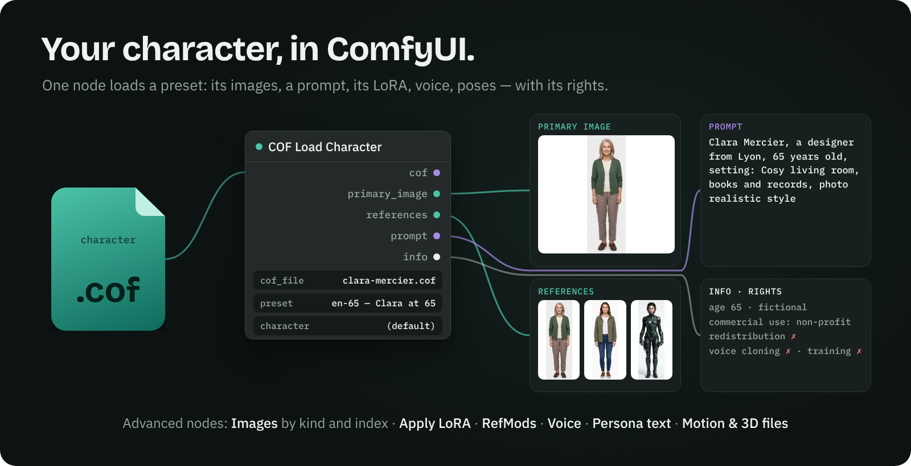

<p align="center"></p>

<h1 align="center">ComfyUI-COF</h1>

<p align="center"><b>Load a whole AI character in ComfyUI — with its rights.</b></p>

<p align="center">
<a href="https://github.com/yannsouetre/cof"></a>&nbsp;&nbsp;&nbsp;
<a href="https://yannsouetre.github.io/cof/viewer/"></a>&nbsp;&nbsp;&nbsp;
<a href="https://yannsouetre.github.io/cof/builder/"></a>
</p>

A **COF (Character Open File)** `.cof` packs a whole AI character — reference views, outfits, places, LoRA, pre-encoded references (RefMods), voice, poses, motion clips, personality, memories (COF 1.1), psyche (COF 1.2) — together with its rights. These nodes turn a **preset** of that character (a language, an age, a style…) into images, a prompt, a LoRA, audio and files for your workflow. No extra Python package is needed.

## Nodes

**One node per category of the COF builder**, in the same order and with the same icons, after the loader. Each takes the loader's `cof` output.

| Node | Inputs | Outputs |
|---|---|---|
| 👤 **COF Load Character** (enough for most workflows) | `.cof` file, **preset** and **character** dropdowns (filled from the selected file), max size, allow intimate | `cof`, primary image, reference images, prompt, info |
| 📝 COF Personality | `cof` | the preset's personality as text (for a language-model node), language |
| 🖼️ COF Appearance | `cof`, **kind** (only the appearance types the preset has, with their counts: clothing — 4 images…), include offered, **pick** (the matching images by name), subject, angle | images, count, labels |
| 🧬 COF Identity Weights · Apply LoRA | model, clip, `cof`, strength (-1 = the weight recommended in the file) | model, clip, trigger words |
| 🧬 COF Identity Weights · Reference Latents (RefMods) | `cof`, models subfolder (default `refmods`) | paths of the exported `.safetensors`, base models |
| 🧊 COF 3D | `cof`, **pick** (the 3D files by name, or all) | paths (exported to `input/3d/`, where **Load 3D** lists them), labels, count |
| 👄 COF Voice | `cof`, **sample** (the voice samples, with their language) | audio, transcript, labels |
| 🏃 COF Postures | `cof`, **kind** (photo, photos, OpenPose, silhouette — with counts), include offered, **pick** | images, count, labels |
| 🎥 COF Motion | `cof`, **pick** (the motion clips by name, or all) | paths (exported to `input/cof/`), labels, count |
| 📁 COF Files | `cof`, **kind** (skill, memory, document…), **pick** | the text of the chosen files, their paths (exported to `input/cof/…/files/`, a skill keeps its folder layout), labels, count |
| 🕰️ COF Memories (COF 1.1) | `cof`, **pick** (the memories by name, oldest first, or all), **media** (one image of the chosen memory, or all), include personal, include text media | the memories as text for a prompt (gist in the preset's language, when-marker, nature / disclosure / fidelity, remembered lines), their images (or the one chosen), the first sound as AUDIO, the sound and video files extracted under `input/cof/` (paths, one per line), labels, count |
| 🧠 COF Psyche (COF 1.2) | `cof`, **format** (`prose`, `lines`, `soul`), **language** (the preset's, or one the gists carry), **focus** (free text: "what she thinks of X"), max nodes, include secret, drop dangerous (on), include personal | `text` (the psyche in the chosen format), `positions` (the stances only, one per line: "toward X: …"), `count` |

The builder's LoRA icon is a drawing; 🧬 stands for it here, and 🧠 for the psyche, which has no builder step yet. **COF Files** reads and exports text files only (Markdown, text, JSON, YAML, CSV): a script inside a skill is listed, never extracted.

- **Presets**: the dropdown lists the presets of the selected file — and, in a file with several characters, those of the selected character. `(default)` is the character's default preset. After adding a `.cof` file, press **R** (refresh) in ComfyUI.
- **One image or several**: `primary_image` is one image, the preset's main one. `references` is a **batch** of every reference view (face, reference set, character sheet, body), for nodes that take several reference images (IP-Adapter, multi-reference editing models). To choose, take **COF Appearance**: its **pick** dropdown lists the images that match, by name (`image_001 — Bright studio facing the park (environment) · background.desktop`…), plus `mosaic_all` for all of them as one batch when there are 24 or fewer, or `mosaic_page_1`, `mosaic_page_2`… (24 at a time) when there are more.
- The dropdowns follow the **COF Load Character** node they are connected to: change the file, the preset or the character, and the lists update.

The **prompt** combines the trigger words of the preset's LoRA, the character's name and visual summary, the preset's age, the outfit, accessories and place applied by the preset, and its visual style.

### COF Psyche (COF 1.2, RFC 0004)

A 1.2 file carries the character's inner life as a **graph of nodes** — values, beliefs, wants, needs, fears, wound, stances, tastes, habits, contradictions, rules — each with a gist per language, a strength (0–100), a stability (`core`, `settled`, `shifting`, `fragile`), the axes of the memories (`origin`, `visibility`, `disclosure`) and typed links to memories, other nodes and characters. The node reads the nodes the preset lists (`slots.psyche`, inherited through `extends`) and renders them as text:

- **`soul`** — the "Who she is" section of cof-cli's `SOUL.md` (`cof export --format agent`), reproduced line for line: a heading per kind in the fixed order wound → values → beliefs → wants → needs → fears → stances → tastes → habits → contradictions → rules, the whole gist at strength 70 or more and a short clause below (first sentence, the elaboration after a dash dropped, cut past 100 characters), the markers `lie` (a belief held and false), `about: X` (the subject of a stance), `guarded`, `lived`, secret nodes left out with one line saying there are things she does not tell. For a language model.
- **`lines`** — one line per node, `kind · gist` (always the whole gist) with the same markers, in the same order. For prompt building: cut, filter or prefix as you like.
- **`prose`** — one compact paragraph for an image or video generator: the values first, then the stances with their subject, then the strongest other nodes (8 at most) as short clauses grouped by kind.

`positions` gives the stances alone, one per line, `toward X: …` — the subject being the user (`about: {"user": true}`), a character of the file, a node's label or the free label of the node; the gist's own "Toward X:" opening is dropped so it is not said twice. `count` is the number of nodes the text holds.

- **language**: the preset's by default (its personality's language, else the character's); the list offers the languages the preset's gists carry, with their counts; each node falls back to the languages it has. The section words (headings, markers) exist in English and French; another language gets the English words around its gists.
- **focus** — the "what she thinks of X" of RFC 0004 § 3 quinquies (constellations): with a text, the node keeps every `core` node plus the nodes whose label, tags, subject or `because` / `about` targets match it — a memory's label, tags, people and places, a character's names, a node's label and tags. Case and accents do not matter; small words (the, of, what, she…) are ignored. `focus = "the Martian"` on Clara gives her stance toward him and her five core nodes.
- **max_nodes**: the strongest N nodes (core first, then by strength), 0 = all.
- **include_secret** (off): `disclosure: secret` nodes are never output unless asked (then marked `secret`). **include_personal** (off): `visibility: personal` nodes are a user's data, as personal memories.
- **drop_dangerous** (on): nodes whose declared `risk` is `dangerous` (would make the character harmful if it acted on them — RFC 0004 § 3 septies) leave the text, and the contradictions that lose a side with them. The RFC gates such nodes by use: an agent that acts must never load them; a fiction host may. **A ComfyUI graph generates — it does not act — and fiction needs villains**, so turn it off for an antagonist; the default stays on the safe side and the console says how many nodes were left out. `inappropriate` nodes are always kept, with a marker. The file-level flags `psyche-dangerous` / `psyche-inappropriate` (`tags.content`) show in the loader's `info` output with the other content flags, so you know before rendering.

When the preset holds psyche nodes, **COF Personality** also ends with one short clause from the strongest value and one from the strongest stance ("Core value: Lightness: do less, better" / "Stance toward design agencies: no rancour, no return") — open nodes only, never a secret, dangerous or personal one. A 1.0 or 1.1 file (no psyche) gives empty outputs, a count of 0 and no clause.

## The character's rules are enforced

- **Adult content is never output by default.** Variants marked `nudity` (no genitals) need `allow_intimate` on and a preset of 18 or over; intimate variants also need the preset's effective `allowSexualUsage`. For a real person, both need their consent in the file.
- Using the **LoRA, references or voice of a real person** without a consent record in the file is **warned** (console and `info` output): you are responsible for that use.
- Only images, audio, video and motion clips, 3D files, text files of the Files category and `.safetensors` are read or extracted — never a script, and nothing in the file is executed. A `.safetensors` with a broken header is refused; extraction paths are built from slugged ids, never from paths found in the file.
- Read the **rights** in the `info` output, or open the file in the explorer: commercial use, redistribution, voice cloning and training are the author's call.

## Install

1. Copy this folder into `ComfyUI/custom_nodes/ComfyUI-COF`, or `git clone https://github.com/yannsouetre/ComfyUI-COF` there. No extra Python package is needed.
2. Put your `.cof` files in `ComfyUI/models/cof/` or `ComfyUI/input/cof/`. To try it, get `clara-mercier.cof` from the COF repository (`viewer/samples/`).
3. Restart ComfyUI. The nodes are in the **COF** category.
4. Drag `workflows/cof_preview.json` onto the canvas (laid out: images at the top; `cof_preview_api.json` is the same workflow in API format):
   - it shows Clara's primary image, her references, her offered outfits, one environment, her poses, her voice, her personality text, her motion clips, the prompt and the info;
   - it needs no model.

   `workflows/cof_txt2img_api.json` adds a checkpoint, the file's LoRA (if any) and a sampler; choose your checkpoint first.

## Using the preview workflow

The workflow opens with a **Read me** note, under the loader, that sums this up. It holds one node of each category (two for Appearance: the outfits, a place), laid out in the builder's order; the identity weights need a model and are in `cof_txt2img_api.json`.

- **The nodes are a fixed template.** They do not appear or disappear with the file's content. Only the **dropdown lists** follow the loaded file, preset and character.
- **Another type** (face, body, hair, accessory…): change **kind** in the node. It lists only the types the preset has, with their number of images or files. A node keeps its type, shown "— 0 images" when this preset has none.
- **Add a node**:
  1. Double-click an empty spot of the canvas, type `COF`, choose the node.
  2. Drag from the `cof` output of **COF Load Character** to the `cof` input of the new node.
  3. Connect a preview (**Preview Image** for images, **Preview Any** for text).
  4. Run.
- **`pick`**: `mosaic_all` shows every matching image (24 at most; beyond 24 the list offers `mosaic_page_1`, `mosaic_page_2`…); `image_001`… shows one image; `all` or `item_001`… for files.
- **include offered** (on by default): also the variants offered with the preset — a spare outfit, an accessory, a pose — available but not applied by default.
- **Missing content**: a preset without voice, 3D, clips or some type of image gives one second of silence, a blank image or an empty list, and says so in the labels. The run goes on.
- **One variant = a consistent set of one thing**: one place for an environment (several framings: desktop and mobile, angles), one garment, one hairstyle… A preset can have several places, each in its own variant. Only a reference set (loose photos) mixes things.

## Tests (outside ComfyUI)

```bash
cd tests && python -m pytest test_nodes.py --import-mode=importlib -c /dev/null
```

The tests stub `torch` and `comfy`. They need six sample files in `tests/samples/`:
- `clara-mercier.cof` and `clara-martien.cof`, from `viewer/samples/` of the COF repository;
- `clara-memories.cof`, the COF repository's `spec/examples/10-clara-mercier` at 1.1 (with memories) packed;
- `clara-psyche.cof`, the same example at 1.2 (with the 22 psyche nodes) packed (`cof pack spec/examples/10-clara-mercier -o tests/samples/clara-psyche.cof`);
- `mixed-adult-minor.cof`, which is the COF repository's `tests/fixtures/mixed-age` packed;
- `refmod.cof`, a test file with a pre-encoded reference.

## Changes

- **0.7.0** — **COF Psyche** (COF 1.2, RFC 0004): the preset's psyche nodes as text — `soul` (cof-cli's "Who she is" section of `SOUL.md`, same order, same strength rule, same markers), `lines` (`kind · gist`, one per node) or `prose` (one paragraph for an image or video generator: values, stances, the strongest traits); the stances alone in `positions` ("toward X: …"); `focus` keeps the nodes that hang on a memory, a character or a subject plus the core ones ("what she thinks of the Martian"); `max_nodes`; the language of the gists (the preset's, or one the gists carry, listed with counts); secret nodes never output unless asked, personal ones neither; `dangerous` nodes dropped by default (a graph generates, it does not act — turn it off for a villain), `inappropriate` ones kept with a marker, the contradictions that lose a side dropped with them.
- **0.7.0** — the reader accepts `cof: "1.2"` files and reads the `psyche` category (variants, node files, `slots.psyche` through `extends`), tolerant of unknown kinds and fields; the file-level content flags (`tags.content`: nudity, `psyche-dangerous`, `psyche-inappropriate`…) appear in the loader's `info` output; **COF Personality** ends with one short clause from the strongest value and one from the strongest stance when the preset holds nodes. Test sample `tests/samples/clara-psyche.cof` (COF example 10 at 1.2).
- **0.6.0** — review of 28 October: the adult rules read the preset's **safety age** — its lowest age including the ages its memories carry (RFC 0002 § 5.2: a preset listing a memory that shows the character as a minor is a minor preset) — while the prompt and the summary keep the age shown; a memory counts as explicit through the variant's 1.0 `nudity` flag and through the node it borrows its media from (`media_from`), not only through its own `explicit`; the **media** list of COF Memories is built with the same effective adult flag as the node (no explicit image offered that the node then refuses); memory media are extracted under a slugged id, never a path taken from the file; a media listed in the manifest but missing from the archive, a damaged image or an invalid manifest give a clean `COFError` or a console line instead of a Python exception.
- **0.6.0** — **COF Memories** gains a **media** list (one image of the chosen memory, `image_001`…, or all as a batch), an **audio** output (the first sound of the chosen memories, silence otherwise) and a **media_paths** output (the sound and video files of the memories extracted under `input/cof/cof-<file>/memories/<id>/`, one path per line — feed a node that loads a video or a sound from a path, or pick them from `input/` after a refresh); the preview workflow previews both.
- **0.6.0** — the preview workflow is laid out in **two columns of groups**, one per category, plus a full-width group for Memories, each collapsible from the dot at its top left; nodes sit on a column and row grid computed from their sizes (title bar and preview room included), the groups fit their nodes, two Read me notes (general, and Memories) are sized to their text; the loader's file list shows `.cof` files only (the clips the Motion node extracts into `models/cof/<name>/` no longer appear in it); COF Memories reopens the file with these nodes when the loader came from an older copy of ComfyUI-COF left in `custom_nodes` (and says so in the console — keep one copy).
- **0.6.0** — the preset's **default prompts** (COF 1.1, RFC 0003 § 4 bis): COF Load Character's `prompt` starts with the preset's scene description when it has one, COF Personality ends with its opening line; the character's gender (RFC 0003) opens the prompt ("woman, Clara Mercier, …"); a preset's identity override (name, summary) is what the prompt and the info describe.
- **0.6.0** — **COF Personality** also states the archetype and the narrative role when the preset's `psyche.json` carries them (COF 1.1, RFC 0003: "Archetype: the Creator (secondary: Explorer)", "Narrative role: protagonist").
- **0.6.0** — **COF Memories** (COF 1.1, RFC 0002): the preset's memories in timeline order (by age, else by date, else by links, undated last) as one text for a language model — the gist in the preset's language, the when-marker, `nature` / `disclosure` / `fidelity`, the short text media (remembered lines) — and their images as a batch; personal memories left out unless asked; the media of an explicit memory only when the loader allows adult content. A 1.0 file gives an empty text and a count of 0. Test sample `tests/samples/clara-memories.cof` (COF example 10, 1.1).
- **0.5.0** — one node per category of the COF builder, with its icon: COF Personality, Appearance, Identity Weights (Apply LoRA, Reference Latents), 3D, Voice, Postures, Motion, Files (new: skills, memories, documents — text files only). COF Images becomes COF Appearance (appearance only; postures have their own node), COF Persona Text becomes COF Personality, COF Motion & 3D Files is split in two. "include offered" is on by default. The preview workflow holds one node per category, in the builder's order, with a Read me note.
- **0.4.0** — the kind list shows only the kinds the preset has, with counts (the node keeps its own kind, even at 0); a preset without a voice gives one second of silence instead of stopping the run; image labels show size and orientation; the prompt leaves out the summary for a preset of another age; the preview workflow opens with a Read me note; images, voice samples and files chosen by name in dropdowns (a mosaic holds 24 images at most; pages of 24 beyond); preview workflow with wider columns.
- **0.3.0** — laid-out preview workflow (`cof_preview.json`), illustrated README, registry metadata.
- **0.2.0** — preset and character dropdowns, image index and labels, voice labels, COF Persona Text, COF Motion & 3D Files.
- **0.1.0** — first version.

## Licence

MIT — Yann Souetre.
